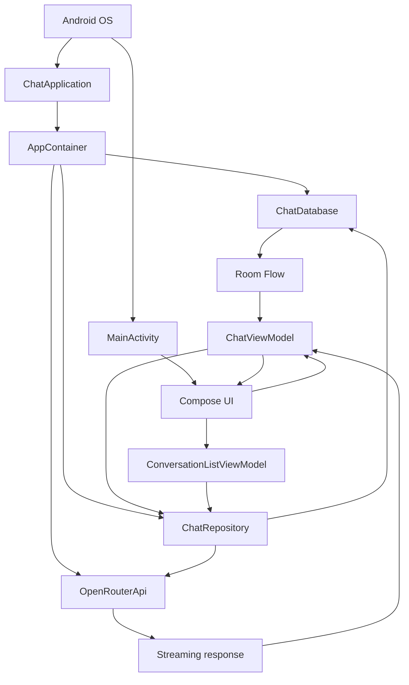
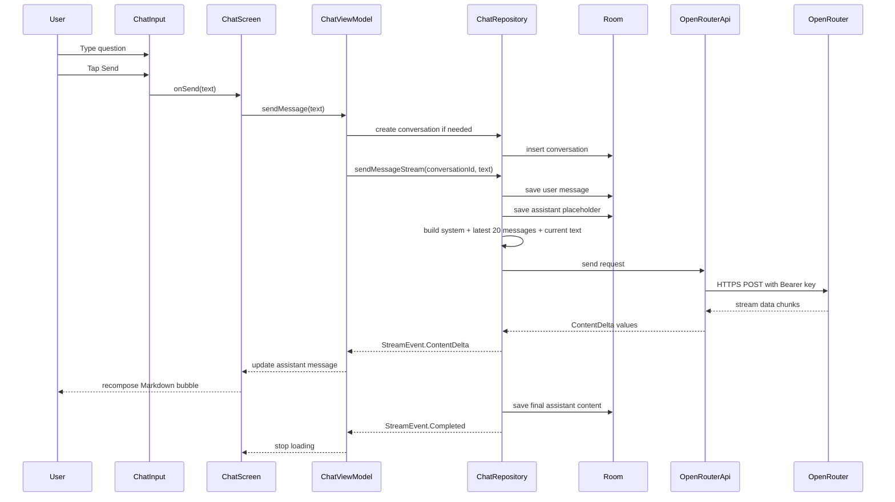

# Chiti Code Android App: Complete Learning Guide

This guide explains the current Chiti Code Android application from beginner Android concepts to the app's architecture, database, network streaming, AI behavior, build process, limitations, and interview-style rapid-fire questions.

The guide describes the code that currently exists in this repository. A dependency, resource, or visible button is not treated as a working feature unless the source code actually uses it.

## How To Use This Guide

Read the sections in order if you are new to Android development. If you already understand Android basics, start with [Project Architecture](#project-architecture), [The Complete Message Flow](#the-complete-message-flow), and [Rapid-Fire Questions](#rapid-fire-questions).

Keep the repository open while reading. Most sections link directly to the source files that implement the behavior being explained.

## 1. What Is Chiti Code?

Chiti Code is a coding-focused Android AI chat application. A user types a programming question, the app sends it to OpenRouter, receives the answer as a stream of text, displays the response as it arrives, and saves the conversation locally.

The app is currently:

- A single-module Android project.
- A single-activity Compose application.
- A single reachable chat screen with a slide-out conversation sidebar.
- An MVVM-style application using ViewModels and a repository.
- A Room-backed local chat history application.
- A fixed-model OpenRouter client.
- A permanently dark Material 3 interface.

The app is not currently:

- A multi-screen Navigation Compose application.
- A full Clean Architecture application with use-case classes and repository interfaces.
- A production-safe API-key architecture.
- An application with working settings, chat search, or response cancellation.
- An image-generation application.

## 2. Quick Project Facts

| Item | Current value |
| --- | --- |
| App name | Chiti Code |
| Application ID | `com.chatai.app` |
| Package root | `com.chatai.app` |
| Version name | `1.4.0` |
| Version code | `5` |
| Minimum Android version | API 26, Android 8.0 |
| Compile SDK | API 34 |
| Target SDK | API 34 |
| Java/Kotlin target | Java 17 |
| Main UI toolkit | Jetpack Compose and Material 3 |
| Local database | Room over SQLite |
| Network client | OkHttp |
| AI provider | OpenRouter |
| Configured model ID | `openai/gpt-5.6-luna` |
| Displayed model name | OpenAI Luna |
| Database name | `chat_database` |
| Database version | `3` |
| Test source files | None currently present |

The Android and version values are defined in [`app/build.gradle.kts`](app/build.gradle.kts#L19-L36). The model values are in [`AiModels.kt`](app/src/main/java/com/chatai/app/data/remote/AiModels.kt#L1-L6).

## 3. What The User Can Do

### 3.1 Open the app

Android starts [`ChatApplication`](app/src/main/java/com/chatai/app/ChatApplication.kt), then launches [`MainActivity`](app/src/main/java/com/chatai/app/MainActivity.kt). The app opens directly on the chat screen.

The app does not automatically reopen the most recent conversation. If no conversation is selected, the user sees the welcome state.

### 3.2 See the welcome screen

When there are no visible messages, the app shows:

- A robot illustration.
- The heading `What can I help you code?`.
- Four example prompts.

The example prompts are:

1. Give me prime number code in Python.
2. Write binary search in Java.
3. Create a prime number program in C.
4. Debug this Kotlin null pointer error.

Tapping a suggestion places its text in the input field. It does not send the question automatically. This behavior is in [`ChatScreen.kt`](app/src/main/java/com/chatai/app/ui/screens/chat/ChatScreen.kt#L96-L100) and [`ChatScreen.kt`](app/src/main/java/com/chatai/app/ui/screens/chat/ChatScreen.kt#L202-L233).

### 3.3 Type and send a question

The input field is a controlled Compose text field. The screen owns the current text and passes it into [`ChatInput`](app/src/main/java/com/chatai/app/ui/components/ChatInput.kt).

The user can send by:

- Tapping the send icon.
- Pressing the keyboard's IME Send action.

Blank messages are rejected. After the send callback is called, the screen clears the input field. The actual operation is performed by [`ChatViewModel.sendMessage`](app/src/main/java/com/chatai/app/ui/screens/chat/ChatViewModel.kt#L98-L122).

### 3.4 Receive a streaming answer

The AI answer does not wait for the complete response before appearing. OpenRouter sends chunks, and the app updates the assistant message as chunks arrive.

The screen shows:

- A loading state while the request is active.
- An assistant message bubble.
- Markdown-rendered content.
- A small streaming indicator while content is being received.

### 3.5 Create and select conversations

The sidebar provides a New Chat action. It creates a conversation row in Room immediately, even if the user never sends a message.

Existing conversations are ordered by `updatedAt`, newest first. Selecting a conversation loads its messages from Room. Deleting a conversation removes the conversation and its messages through two DAO operations.

### 3.6 View formatted answers

Assistant responses are rendered through Markwon inside a regular Android `TextView` embedded in Compose. The configured renderer supports:

- Markdown.
- Strikethrough.
- Tables.
- HTML.
- Clickable links.
- Markdown images loaded through Coil.
- Normal Markdown code blocks.

The syntax-highlighting dependency is present, but the syntax-highlighting plugin is not registered. Language-aware syntax highlighting should therefore not be described as a completed feature.

### 3.7 See local history

Conversations and messages are stored locally in a Room database. The conversation list and selected conversation are observed using Kotlin `Flow`, so database changes can update the Compose UI.

### 3.8 See errors

Errors are exposed through a `StateFlow` and displayed in a Material Snackbar. Error strings currently mix English and Vietnamese, and some raw network error text can be displayed directly.

## 4. Features: Implemented, Partial, And Missing

| Feature | Status | Explanation |
| --- | --- | --- |
| Coding chat | Implemented | The system prompt focuses the model on programming and software development. |
| OpenRouter request | Implemented | The app sends a chat-completion request to OpenRouter. |
| Streaming text | Implemented | The response body is read line by line and content deltas are emitted. |
| New chat | Implemented | A new Room conversation is created and selected. |
| Select chat | Implemented | A conversation can be selected from the sidebar. |
| Delete chat | Implemented | The conversation and messages are deleted. |
| Automatic title | Implemented simply | The first prompt is truncated to 40 characters; the AI does not generate the title. |
| Local history | Implemented | Room stores conversations and messages. |
| Markdown rendering | Implemented | Markwon renders assistant content. |
| Tables and HTML | Implemented | Markwon plugins are registered. |
| Markdown images | Implemented | Remote image URLs may be loaded through Coil. |
| Code blocks | Implemented | Core Markdown rendering supports them. |
| Syntax highlighting | Not configured | The dependency exists, but no highlight plugin is registered. |
| Search chats | Placeholder only | The sidebar displays search text but has no input or filter logic. |
| Settings screen | Missing | Settings strings exist, but no settings screen is reachable. |
| Runtime API-key editor | Missing | The key is supplied during the build, not in the app. |
| Stop generation | Missing | The Stop icon branch contains a TODO and does not cancel the request. |
| Image generation | Missing by design | The system prompt tells the model not to generate images. |
| Light theme | Missing | The theme always uses the dark color scheme. |
| Automated tests | Missing | No unit or instrumentation test files are present. |

## 5. Android Fundamentals Used By This Project

This section explains the basic Android concepts needed before reading the app's Kotlin code.

### 5.1 Android application

An Android application is a package installed on a device. It contains compiled Kotlin/Java code, resources, a manifest, and metadata. Android assigns the installed application an application ID, which is `com.chatai.app` here.

The application ID is not merely a Kotlin package name. Android uses it to identify the installed app, its data directory, its Room database, and its package-level permissions.

### 5.2 AndroidManifest.xml

The manifest tells Android about application components, permissions, launch behavior, backup policy, and other app metadata.

This project's [`AndroidManifest.xml`](app/src/main/AndroidManifest.xml) declares:

- The custom `ChatApplication` class.
- `MainActivity` as the launcher activity.
- `INTERNET` permission for OpenRouter and remote Markdown images.
- `ACCESS_NETWORK_STATE`, although no current Kotlin code uses it.
- A dark icon/theme configuration.
- `android:allowBackup="true"`.
- Edge-to-edge and keyboard-related activity behavior.

### 5.3 Application class

The [`Application`](app/src/main/java/com/chatai/app/ChatApplication.kt) object represents the app process. It is created before activities and is appropriate for process-wide initialization.

Chiti Code uses `ChatApplication.onCreate()` to:

1. Create the application dependency container.
2. Install a global uncaught-exception handler.

The Application is not a screen. It should not contain UI state that belongs to a particular screen.

### 5.4 Activity

An Activity is an Android component that provides a window and a lifecycle. [`MainActivity`](app/src/main/java/com/chatai/app/MainActivity.kt) is the only declared activity.

Its job is intentionally small:

1. Enable edge-to-edge drawing.
2. Call `setContent`.
3. Apply the Compose theme.
4. Obtain the conversation list ViewModel.
5. Display `ChatScreen`.

The app does not use multiple activities for settings, details, or conversations.

### 5.5 Activity lifecycle

Android can create, stop, destroy, and recreate an Activity. Rotation, multi-window changes, memory pressure, and process death affect lifecycle behavior.

Compose state stored only with `remember` is not guaranteed to survive Activity recreation. A ViewModel usually survives configuration changes, but it does not automatically survive process death unless state is saved using mechanisms such as `SavedStateHandle` or persistent storage.

In this app:

- ViewModels hold important chat state during their lifetime.
- The selected conversation is not explicitly restored after process death.
- Draft input and sidebar visibility use regular `remember` state.
- Room remains the durable source for saved conversations and messages.

### 5.6 Resources

Resources are non-Kotlin app assets such as strings, colors, XML themes, drawables, and icons. Android generates resource identifiers such as `R.string.app_name`.

The app has resources under [`app/src/main/res`](app/src/main/res), including:

- `values/strings.xml` for text.
- `values/colors.xml` for XML colors.
- `values/themes.xml` for the platform theme.
- `drawable/` and `mipmap/` for launcher assets.
- `xml/network_security_config.xml` for network policy.

Many visible strings are currently hard-coded inside Kotlin rather than loaded from `strings.xml`, so localization is incomplete.

### 5.7 Gradle

Gradle is the build system. It resolves dependencies, compiles Kotlin, generates resources and BuildConfig, runs tests, packages APKs, shrinks release builds, and signs artifacts.

The Gradle wrapper files allow contributors to use the repository's expected Gradle version without installing Gradle globally. This project uses Gradle 8.5.

Important build files:

- [`settings.gradle.kts`](settings.gradle.kts): repositories, project name, and module inclusion.
- [`build.gradle.kts`](build.gradle.kts): root plugins and plugin versions.
- [`app/build.gradle.kts`](app/build.gradle.kts): Android configuration and app dependencies.
- [`gradle.properties`](gradle.properties): Gradle and AndroidX settings.
- [`gradle/wrapper/gradle-wrapper.properties`](gradle/wrapper/gradle-wrapper.properties): wrapper version.

### 5.8 APK and build variants

An APK is an installable Android package. A debug APK is intended for development and normally uses debug signing. A release APK is optimized and signed for distribution.

This project has two build types:

- `debug`: minification is disabled.
- `release`: R8 minification and resource shrinking are enabled, and release signing variables are expected.

The app does not currently define product flavors.

## 6. Kotlin Concepts Used In The App

### 6.1 `val` and `var`

`val` is a read-only reference after initialization. `var` can be reassigned. Kotlin code generally prefers `val` unless reassignment is required.

Examples in this app include immutable request values and mutable state holders such as `var currentConversationId` inside the ViewModel.

### 6.2 Classes and constructors

Classes group state and behavior. Constructor parameters can be declared directly in the class header.

The API class receives no constructor dependency in the current implementation, while `ChatRepository` receives database DAOs and an API client through its constructor.

### 6.3 Data classes

`data class` is used for value-shaped objects such as [`Conversation`](app/src/main/java/com/chatai/app/domain/model/Conversation.kt) and [`ChatMessage`](app/src/main/java/com/chatai/app/domain/model/ChatMessage.kt).

Kotlin generates useful methods for data classes, including:

- `equals` and `hashCode` based on values.
- `toString`.
- `copy` for creating a changed version.
- Component functions for destructuring.

The UI uses `copy` when replacing a streaming assistant message with updated content.

### 6.4 Nullable types

Kotlin distinguishes a non-null type such as `String` from a nullable type such as `String?`.

The app uses nullable values for:

- The selected conversation ID before a chat is created.
- Optional API response content.
- Optional error state.
- Optional Room image metadata retained for legacy compatibility.

The compiler forces code to handle or safely unwrap nullable values.

### 6.5 Default arguments

Kotlin constructors and functions can provide defaults. The message model uses defaults for generated IDs, timestamps, and streaming state. This makes creation concise while ensuring new messages get a UUID and timestamp when the caller does not provide them.

### 6.6 Extension functions

An extension function adds callable behavior to an existing type without modifying that type. The entity files use conversion functions such as `toDomainModel()` and companion conversion functions such as `fromDomainModel()`.

This is a lightweight data-mapping approach between Room entities and domain objects.

### 6.7 Companion objects

A companion object holds members associated with a class rather than a particular instance. [`ChatDatabase`](app/src/main/java/com/chatai/app/data/local/ChatDatabase.kt) uses a companion object to expose a singleton database factory.

### 6.8 `object` and singleton behavior

Kotlin's `object` keyword creates a singleton object. This project mainly uses a companion object plus synchronized double-checked locking for the Room database singleton.

The database is intended to have one instance per process so that multiple DAOs share the same database connection and invalidation system.

### 6.9 Sealed classes

[`StreamEvent`](app/src/main/java/com/chatai/app/data/repository/ChatRepository.kt#L142-L148) is a sealed class hierarchy representing known streaming events:

- User message saved.
- Assistant message started.
- New content delta.
- Stream completed.
- Stream failed.

Because the hierarchy is closed, a `when` expression can check all event types. This is safer than passing around arbitrary event strings.

### 6.10 Lambdas and callbacks

A lambda is a function value. Compose uses callbacks heavily:

- `onMessageChange` updates text.
- `onSend` starts a request.
- `onConversationSelected` selects a chat.
- `onDeleteConversation` deletes a chat.

This allows reusable UI components to report user actions without knowing how the parent stores or processes them.

### 6.11 `suspend` functions

A `suspend` function can pause and resume inside a coroutine without blocking the underlying thread. Room DAO writes and repository operations use suspend functions because database and network work should not block the main UI thread.

Suspending does not automatically mean a new thread is used. The coroutine dispatcher determines where the work runs.

### 6.12 `try`, `catch`, and `finally`

The repository and ViewModel catch exceptions so the app can stop loading, log the failure, and display a Snackbar rather than crashing for every request error.

Error handling is incomplete in places: raw network text can reach the user, partial responses can remain in the database, and malformed streaming chunks are logged and skipped.

### 6.13 `use` blocks

Kotlin's `use` function closes a closeable resource after the block finishes. The network code uses a response body inside a `use` block so the HTTP response stream is closed.

### 6.14 Generics

Types such as `Flow<List<Conversation>>` communicate both the stream type and the emitted value type. Generics let Room and coroutines remain reusable while preserving compile-time type safety.

## 7. Project Structure And File Map

The source root is [`app/src/main/java/com/chatai/app`](app/src/main/java/com/chatai/app).

### 7.1 Root application files

| File | Responsibility |
| --- | --- |
| [`ChatApplication.kt`](app/src/main/java/com/chatai/app/ChatApplication.kt) | Process startup, dependency container, uncaught crash handler. |
| [`MainActivity.kt`](app/src/main/java/com/chatai/app/MainActivity.kt) | Single Activity and Compose entry point. |
| [`CrashLogger.kt`](app/src/main/java/com/chatai/app/CrashLogger.kt) | Writes application errors and crashes to app-specific files. |

### 7.2 Dependency composition

| File | Responsibility |
| --- | --- |
| [`AppContainer.kt`](app/src/main/java/com/chatai/app/di/AppContainer.kt) | Manually creates the database, API client, and repository. |

### 7.3 Domain layer

| File | Responsibility |
| --- | --- |
| [`Conversation.kt`](app/src/main/java/com/chatai/app/domain/model/Conversation.kt) | In-memory conversation model. |
| [`ChatMessage.kt`](app/src/main/java/com/chatai/app/domain/model/ChatMessage.kt) | In-memory chat message model. |

The domain layer is small. There are no use-case classes or repository interfaces.

### 7.4 Local data layer

| File | Responsibility |
| --- | --- |
| [`ChatDatabase.kt`](app/src/main/java/com/chatai/app/data/local/ChatDatabase.kt) | Room database declaration, version, migration, and singleton creation. |
| [`ConversationDao.kt`](app/src/main/java/com/chatai/app/data/local/dao/ConversationDao.kt) | Conversation queries and writes. |
| [`MessageDao.kt`](app/src/main/java/com/chatai/app/data/local/dao/MessageDao.kt) | Message queries and writes. |
| [`ConversationEntity.kt`](app/src/main/java/com/chatai/app/data/local/entity/ConversationEntity.kt) | Room conversation table row and mapping. |
| [`MessageEntity.kt`](app/src/main/java/com/chatai/app/data/local/entity/MessageEntity.kt) | Room message table row and mapping. |

### 7.5 Remote data layer

| File | Responsibility |
| --- | --- |
| [`AiModels.kt`](app/src/main/java/com/chatai/app/data/remote/AiModels.kt) | Fixed model ID and display label. |
| [`OpenRouterApi.kt`](app/src/main/java/com/chatai/app/data/remote/OpenRouterApi.kt) | HTTP request, response-body reading, and stream parsing. |
| [`ChatRequest.kt`](app/src/main/java/com/chatai/app/data/remote/dto/ChatRequest.kt) | Gson request and response DTOs. |

### 7.6 Repository

| File | Responsibility |
| --- | --- |
| [`ChatRepository.kt`](app/src/main/java/com/chatai/app/data/repository/ChatRepository.kt) | Coordinates Room persistence, OpenRouter streaming, context assembly, and title creation. |

### 7.7 Presentation layer

| File | Responsibility |
| --- | --- |
| [`ChatScreen.kt`](app/src/main/java/com/chatai/app/ui/screens/chat/ChatScreen.kt) | Main screen composition, layout, state collection, and Snackbar display. |
| [`ChatViewModel.kt`](app/src/main/java/com/chatai/app/ui/screens/chat/ChatViewModel.kt) | Chat state, send/select/delete operations, and stream-event handling. |
| [`ConversationListViewModel.kt`](app/src/main/java/com/chatai/app/ui/screens/conversations/ConversationListViewModel.kt) | Observes the Room conversation list. |
| [`ConversationListScreen.kt`](app/src/main/java/com/chatai/app/ui/screens/conversations/ConversationListScreen.kt) | Unused empty screen stub. |
| [`Sidebar.kt`](app/src/main/java/com/chatai/app/ui/components/Sidebar.kt) | Drawer, New Chat, history rows, dates, and delete actions. |
| [`ChatInput.kt`](app/src/main/java/com/chatai/app/ui/components/ChatInput.kt) | Text input, send action, and visual loading/stop button. |
| [`MessageBubble.kt`](app/src/main/java/com/chatai/app/ui/components/MessageBubble.kt) | User and assistant message presentation. |
| [`MarkdownContent.kt`](app/src/main/java/com/chatai/app/ui/components/MarkdownContent.kt) | Markwon configuration and Compose/View interoperability. |
| [`Theme.kt`](app/src/main/java/com/chatai/app/ui/theme/Theme.kt) | Material 3 color scheme and system bar styling. |
| [`Color.kt`](app/src/main/java/com/chatai/app/ui/theme/Color.kt) | App color constants. |

## 8. Project Architecture

### 8.1 High-level architecture



### 8.2 Presentation layer

The presentation layer includes Compose functions and ViewModels.

Compose functions describe what the UI should look like for a given state. They do not normally perform database or network work directly.

The ViewModels expose state and handle user actions. They call the repository rather than writing SQL or constructing HTTP requests themselves.

### 8.3 Domain layer

The domain layer contains `Conversation`, `ChatMessage`, and `StreamEvent` concepts. It is not a complete independent business layer because there are no use cases and some presentation code imports remote model constants directly.

### 8.4 Data layer

The data layer contains:

- Room entities and DAOs for local storage.
- OpenRouter DTOs and API code for remote communication.
- The repository that coordinates both sources.

### 8.5 MVVM

MVVM means Model-View-ViewModel:

- **Model:** domain objects and data sources.
- **View:** Compose UI functions.
- **ViewModel:** state holder and action coordinator between the UI and data layer.

In Chiti Code:

- `ChatScreen` is the View.
- `ChatViewModel` is the ViewModel.
- `ChatRepository`, Room, OpenRouter, and domain models form the Model/data side.

The UI observes state rather than directly asking the database for every redraw.

### 8.6 Repository pattern

The repository hides the details of where data comes from. `ChatRepository` knows how to:

- Save and observe Room data.
- Build API history.
- Start a streaming OpenRouter request.
- Convert network output into `StreamEvent` values.
- Update the database after completion.

The current repository is concrete and has no interface. That makes the app simpler, but it makes replacement and unit testing harder.

### 8.7 Manual dependency injection

Dependency injection means giving a class the objects it needs instead of making those objects internally.

`AppContainer` manually creates the database, API object, and repository. ViewModels retrieve the container through `ChatApplication`.

This is both:

- Manual dependency injection, because dependencies are created in one composition location.
- A service locator, because ViewModels find dependencies through a global application object.

The project does not use Hilt, Dagger, or Koin.

### 8.8 Singleton database

Room database creation uses a singleton pattern so the application reuses one database instance. `@Volatile`, `synchronized`, and double-checked locking are used to avoid creating multiple instances from concurrent calls.

### 8.9 Data mapping

Room entities are persistence models. Domain models are application models. Conversion functions keep those concerns separate:

```text
ConversationEntity <-> Conversation
MessageEntity      <-> ChatMessage
```

The mapping is manual, so database column changes do not automatically change the domain model.

### 8.10 What this architecture is not

Do not call this full Clean Architecture. The project does not currently have:

- Use-case/interactor classes.
- Repository interfaces.
- A domain module separate from the app module.
- Strict dependency direction enforcement.
- Hilt or another DI framework.

It is better described as a small layered MVVM application with a repository and manual dependency container.

## 9. Application Startup Flow

The startup sequence is:

1. Android reads the manifest.
2. Android creates `ChatApplication`.
3. `ChatApplication.onCreate()` creates `AppContainer`.
4. The container creates the Room database, API client, and repository.
5. The application installs the uncaught-exception handler.
6. Android creates `MainActivity`.
7. `MainActivity` enables edge-to-edge content.
8. `setContent` starts the Compose hierarchy.
9. `ChitiCodeTheme` applies the dark Material 3 theme.
10. The conversation list ViewModel observes Room conversations.
11. `ChatScreen` obtains `ChatViewModel` and observes its state.
12. Because no conversation is selected initially, the welcome screen is shown.

The main startup files are [`AndroidManifest.xml`](app/src/main/AndroidManifest.xml#L5-L28), [`ChatApplication.kt`](app/src/main/java/com/chatai/app/ChatApplication.kt#L14-L42), and [`MainActivity.kt`](app/src/main/java/com/chatai/app/MainActivity.kt#L17-L35).

## 10. Jetpack Compose Concepts In This App

### 10.1 Declarative UI

Traditional Android UI often changes views manually. Compose uses a declarative approach: a composable function receives state and describes the UI for that state.

For example:

```kotlin
if (messages.isEmpty()) {
    WelcomeScreen(...)
} else {
    MessageList(messages)
}
```

When `messages` changes, Compose recomposes the relevant functions and updates the UI.

### 10.2 Composable functions

Functions marked with `@Composable` can call other composables and participate in the Compose runtime. `ChatScreen`, `Sidebar`, `ChatInput`, and `MessageBubble` are composable functions.

### 10.3 Recomposition

Recomposition means Compose reruns composable code whose observed inputs changed. It does not necessarily recreate the entire screen or Activity.

Room and ViewModel flows trigger state updates. Those state updates cause the relevant UI to recompose.

### 10.4 State hoisting

State hoisting means keeping state in a parent and passing the value plus callbacks to a child.

`ChatInput` does not own the authoritative message text. It receives:

- The current `message` value.
- `onMessageChange` callback.
- `onSend` callback.
- Loading state.

This keeps the input component reusable and makes the parent responsible for the data flow.

### 10.5 `remember`

`remember` stores a value across recompositions. `ChatScreen` remembers sidebar visibility, input text, lazy-list state, and Snackbar state.

`remember` does not guarantee survival across Activity recreation or process death. `rememberSaveable` or persistent storage is needed for stronger restoration.

### 10.6 `collectAsState`

`collectAsState` converts a Kotlin `Flow` or `StateFlow` into Compose-observable state.

The app uses it for:

- Conversation list.
- Current messages.
- Loading state.
- Error state.
- Selected conversation ID.

The app uses ordinary `collectAsState`, not the lifecycle-aware `collectAsStateWithLifecycle`.

### 10.7 `LaunchedEffect`

`LaunchedEffect` starts a coroutine tied to the composable lifecycle and restarts it when its key changes.

The screen uses effects to:

- Scroll to the final message when the message count changes.
- Show a Snackbar when the error state becomes non-null.

The scroll effect is keyed by `messages.size`, so token updates that change only message content do not continuously trigger scrolling.

### 10.8 `LazyColumn`

`LazyColumn` displays a vertically scrolling list while composing only visible items. The chat message list uses stable message IDs as item keys.

### 10.9 Android View interoperability

Markwon is built around Android `TextView`. `MarkdownContent` uses `AndroidView` to embed that traditional View inside Compose. This is an example of interoperability: Compose and the older Android View system can coexist.

### 10.10 Material 3

Material 3 supplies components such as:

- `Surface`.
- `OutlinedTextField`.
- `SnackbarHost`.
- Buttons and icons.
- Material color roles.

The app defines a custom dark color scheme in [`Theme.kt`](app/src/main/java/com/chatai/app/ui/theme/Theme.kt).

The theme function accepts `darkTheme` and `dynamicColor` parameters but currently ignores them and always chooses the dark scheme.

## 11. UI Runtime Flow

### 11.1 Main screen state

`ChatScreen` observes:

- `messages`.
- `isLoading`.
- `error`.
- `currentConversationId`.

It also owns short-lived UI state:

- Sidebar open/closed.
- Current draft text.
- Lazy list scroll state.
- Snackbar host state.

### 11.2 Header

The header contains:

- Menu icon to open the sidebar.
- Fixed `OpenAI Luna` model label.

There is no model selector, current-chat title in the header, settings icon, login system, or user profile.

### 11.3 Sidebar

The sidebar contains:

- Header and close button.
- New Chat control.
- Decorative search area.
- Conversations grouped by date.
- Delete icon for each conversation.

The drawer is an overlay, not a separate Navigation destination.

### 11.4 Message list

The message list uses `LazyColumn`. User messages are shown as plain text with a `You` label. Assistant messages are shown with the fixed `OpenAI Luna` label and Markdown rendering.

Unknown message roles are treated as assistant messages because the UI checks for `user` and uses the assistant branch for everything else. A sealed role type would be safer.

### 11.5 Input

The input is disabled while `isLoading` is true. The idle send icon changes visually to a stop icon while loading, but the stop branch is not implemented.

## 12. ViewModel And State Management

### 12.1 ConversationListViewModel

`ConversationListViewModel` obtains the repository from the application container and collects `observeConversations()` inside `viewModelScope`.

Its responsibility is narrow: expose the latest Room conversation list to Compose.

### 12.2 ChatViewModel state

`ChatViewModel` owns:

- The selected conversation ID.
- The visible message list.
- Loading state.
- Error state.
- The ID of the streaming message.
- An in-memory `chatHistory` used to build future API requests.

It extends `AndroidViewModel` because it needs an Application reference to reach the container and crash logger.

### 12.3 New conversation

`startNewChat()`:

1. Calls the repository to create a Room conversation.
2. Stores its ID as the current conversation.
3. Clears visible messages.
4. Clears in-memory history.
5. Starts observing that conversation's messages.

### 12.4 Select conversation

`selectConversation(id)`:

1. Avoids work if the ID is already selected.
2. Sets the current conversation ID.
3. Clears current UI/history state.
4. Starts a Room message collector for the new ID.

### 12.5 Send message

`sendMessage(text)`:

1. Rejects blank text.
2. Rejects an empty build-time API key.
3. Creates a conversation if none is selected.
4. Sets loading state.
5. Calls the repository's streaming operation.
6. Handles each `StreamEvent`.
7. Clears loading state when complete or failed.

### 12.6 Delete conversation

Deletion calls the repository. If the deleted conversation was selected, the ViewModel clears the selected ID, messages, and history so the welcome screen returns.

### 12.7 `viewModelScope`

`viewModelScope` is cancelled when the ViewModel is permanently cleared. It is the correct default scope for screen-related asynchronous work because operations should not outlive the ViewModel indefinitely.

The current implementation launches message collectors repeatedly without storing and cancelling their jobs. This is an important correctness issue described in [Known Problems](#known-problems-in-the-current-implementation).

## 13. Room Database And Local Persistence

### 13.1 What is Room?

Room is an Android persistence library over SQLite. It provides:

- Kotlin classes for database tables.
- DAO interfaces for SQL operations.
- Compile-time query validation.
- Coroutine and Flow integration.
- Generated implementations through annotation processing.

This project uses KSP to generate Room code.

### 13.2 Database declaration

[`ChatDatabase`](app/src/main/java/com/chatai/app/data/local/ChatDatabase.kt) declares:

- `ConversationEntity` as a table.
- `MessageEntity` as a table.
- Database version `3`.
- DAOs for both tables.

The database file is named `chat_database`.

### 13.3 Conversation table

The conversation entity contains:

- UUID string ID.
- Title.
- Creation timestamp.
- Last-updated timestamp.

The conversation DAO queries rows by descending `updatedAt`, so recently used conversations appear first.

### 13.4 Message table

The message entity contains:

- UUID string ID.
- Conversation ID.
- Role such as `user` or `assistant`.
- Content.
- Timestamp.
- Model name.
- Legacy image metadata fields.

The domain `ChatMessage` also has an `isStreaming` property, but that property is not stored in the Room entity. It is temporary UI/domain state.

### 13.5 DAO

A DAO is an interface containing database operations. Room generates the implementation.

The app uses:

- `Flow<List<ConversationEntity>>` for reactive conversation observation.
- `Flow<List<MessageEntity>>` for reactive message observation.
- `suspend` insert, update, and delete operations for asynchronous work.

When a relevant table changes, Room invalidates the query and emits updated results to collectors.

### 13.6 Room and domain mapping

The repository maps entities into domain objects before exposing them to the ViewModel. This prevents the UI from depending directly on SQLite column classes.

### 13.7 Database migration

The database includes a version 1 to version 2 migration that adds legacy image columns. The current database version is 3, but there is no explicit version 2 to version 3 migration.

The database enables `fallbackToDestructiveMigration()`. If Room cannot find a migration path, it may delete and recreate the database. That can erase local conversation history.

For production, every supported schema transition should have an explicit migration and migration tests.

### 13.8 Database integrity limitations

The current schema has no declared foreign key from messages to conversations. Deletion is performed in two separate operations rather than a transaction. A failure between those operations could leave orphan messages.

There is also no index on `conversationId`, even though messages are queried by that column.

### 13.9 Local data privacy

Chat prompts and answers are stored as ordinary local database content. No SQLCipher or application-level encryption is configured. The app also allows Android backup by default.

Do not paste passwords, private keys, production credentials, or confidential source code into the app unless you understand where the data is stored and transmitted.

## 14. Networking And OpenRouter

### 14.1 OkHttp

OkHttp is an HTTP client. `OpenRouterApi` creates one client with:

- 30-second connection timeout.
- 120-second read timeout.
- 30-second write timeout.

The request is sent to:

```text
https://openrouter.ai/api/v1/chat/completions
```

### 14.2 Authentication

The API key is sent using the HTTP header:

```text
Authorization: Bearer <API_KEY>
```

The code also sends OpenRouter attribution headers for the application URL and title.

### 14.3 Gson and DTOs

Gson serializes Kotlin request objects into JSON and parses response JSON into DTO objects.

DTO means Data Transfer Object. It represents the shape of data crossing a network boundary. DTOs are not necessarily the same as domain models.

The request contains:

- `model`.
- `messages`.
- `stream = true`.

The message DTO contains a role and content.

### 14.4 Server-Sent Events

Server-Sent Events, or SSE, allow a server to send a sequence of text events over one long-lived HTTP response. The OpenRouter stream sends lines similar to:

```text
data: {"choices":[{"delta":{"content":"Hello"}}]}
data: {"choices":[{"delta":{"content":" world"}}]}
data: [DONE]
```

The app manually reads the response body line by line. For lines beginning with `data: `, it parses the JSON and extracts `choices[0].delta.content`.

The declared `okhttp-sse` dependency is not used. The implementation uses a normal OkHttp `Call` and manual parsing.

### 14.5 `Flow`

`OpenRouterApi.sendMessageStream()` returns a cold Kotlin `Flow`. Cold means the code inside the flow does not start until a collector calls `collect`.

The repository's stream work begins when the ViewModel collects it. `flowOn(Dispatchers.IO)` moves upstream network/database work to an IO dispatcher.

The downstream collector in the ViewModel still runs according to its coroutine context unless another context change is applied.

### 14.6 Streaming limitations

The parser currently:

- Accepts only lines beginning exactly with `data: `.
- Does not assemble multiline SSE data fields.
- Logs malformed chunks and skips them.
- Does not robustly model mid-stream provider errors.
- Treats end-of-stream without `[DONE]` as a normal completion in some paths.
- Does not retain an OkHttp `Call` for explicit cancellation.

The app can therefore save an incomplete or empty answer in certain failure cases.

## 15. AI Behavior And Prompt Context

### 15.1 Fixed model

The API always requests:

```text
openai/gpt-5.6-luna
```

The UI displays:

```text
OpenAI Luna
```

There is no model picker or fallback model.

### 15.2 System prompt

The repository sends a system message that instructs the AI to:

- Answer programming and software-development questions.
- Help with code, algorithms, data structures, debugging, reviews, APIs, databases, testing, and developer tools.
- Use the user's requested programming language.
- Choose an appropriate language when none is specified.
- Use labeled Markdown code blocks.
- Explain code briefly when useful.
- Refuse non-coding questions.
- Respond in the user's language.
- Refuse image-generation requests.

This is behavioral guidance for the remote model, not a security boundary. A prompt can attempt to override it, and the model ultimately decides how to respond.

### 15.3 Context window used by this app

For each request, the repository builds:

1. The system prompt.
2. The latest 20 prior user and assistant messages.
3. The current user message.

This is a message-count limit, not a token-count limit. Twenty very long messages can still exceed a provider's context or request limits.

The app does not configure temperature, maximum output tokens, top-p, tools, function calling, or structured output.

### 15.4 Automatic title behavior

The title is not generated by the AI. After the first successful response, the first user prompt becomes the title. If it is longer than 40 characters, it is truncated and `...` is appended.

If the first request fails, the title can remain `New Chat`.

## 16. The Complete Message Flow

This is the most important flow to understand in the project.



### Step 1: User action

`ChatInput` calls its `onSend` callback. `ChatScreen` checks that the text is not blank, calls `ChatViewModel.sendMessage`, and clears the draft field.

### Step 2: Validate and choose conversation

The ViewModel rejects blank input and an empty API key. If there is no selected conversation, it creates one first.

### Step 3: Persist the user message

The repository saves the user message in Room before calling OpenRouter. This means the user message can remain in history even if the network request fails.

### Step 4: Persist assistant placeholder

The repository inserts an empty assistant message. Streaming content later updates this row.

### Step 5: Build API messages

The repository adds the system prompt, recent history, and current user message. It limits previous messages to the latest 20.

### Step 6: Start HTTP stream

`OpenRouterApi` sends the JSON request with the model, messages, stream flag, and Bearer authorization.

### Step 7: Parse chunks

The API reads each `data: ` line, parses JSON, extracts text, and emits a content value through a Flow.

### Step 8: Update ViewModel state

The repository converts network output into `StreamEvent` values. The ViewModel finds the active assistant message and replaces it with a copied message containing the accumulated content.

### Step 9: Compose recomposes

The `messages` StateFlow emits a new list. Compose observes it, recomposes the message list, and Markwon renders the latest assistant Markdown.

### Step 10: Complete and persist

When the stream completes, the repository saves final content, updates the title if appropriate, and emits completion. The ViewModel stops loading.

## 17. Markdown And Response Rendering

### 17.1 Markwon

Markwon is a Markdown rendering library for Android. This app configures it in [`MarkdownContent.kt`](app/src/main/java/com/chatai/app/ui/components/MarkdownContent.kt#L20-L59).

The configured plugins are:

- Core Markdown.
- Strikethrough.
- Tables.
- HTML.
- Linkify.
- Coil image loading.

### 17.2 Compose/View bridge

Markwon expects an Android `TextView`, while the rest of the UI uses Compose. `AndroidView` embeds a `TextView` into Compose, and an update block applies the current Markdown content.

This pattern is useful when a required library has no native Compose component.

### 17.3 Code blocks

Regular code blocks can render through Markwon's core Markdown support. However, the syntax-highlight artifact is not connected to the Markwon builder. There is no configured language parser, code-copy button, or custom code-block toolbar.

### 17.4 Links and images

Links are made clickable using Android movement methods. Markdown image URLs may trigger network requests through Coil.

Remote image loading can expose device network metadata to third-party image hosts. AI-generated Markdown should be treated as untrusted content.

### 17.5 HTML

HTML support is enabled. This increases formatting flexibility but also expands the content that a remote model can place into a native text renderer. A production app should evaluate whether HTML is needed and restrict unsafe schemes and behavior.

## 18. Errors, Loading, And Crash Logging

### 18.1 Loading state

The ViewModel sets `_isLoading` before the streaming request and clears it on completion or failure. The UI uses it to disable typing and change the send icon visually.

### 18.2 Snackbar errors

`ChatScreen` observes `error`. When it becomes non-null, a `LaunchedEffect` shows a Snackbar and asks the ViewModel to clear the error.

This works for the current app, but error state is being used as a one-time event. A channel or event wrapper can be more appropriate when the same error must never replay.

### 18.3 Error categories currently shown

- Missing API key.
- New conversation failure.
- Network/API failure.
- Stream failure.
- Delete failure.
- Generic system/coroutine failure.

The text is not consistently localized. Some provider error bodies can be exposed to the Snackbar.

### 18.4 Global uncaught-exception handler

`ChatApplication` installs a handler that:

1. Writes crash details with `CrashLogger`.
2. Logs the stack trace to Logcat.
3. Delegates to Android's previous/default handler.

Delegating is important because swallowing the exception would make a fatal crash appear artificially hidden.

### 18.5 Crash log location

Logs are written to app-specific external files when possible, with an internal files directory fallback. The logs include timestamps, app/device details, exception messages, stack traces, and causes.

There is no retention policy, upload service, in-app viewer, or privacy consent flow.

## 19. Security And Privacy

This section is especially important for learning the difference between development convenience and production security.

### 19.1 API key is embedded in the APK

The Gradle script reads `OPENROUTER_API_KEY` from a project property or `local.properties`, then writes it into `BuildConfig`.

This prevents the key from being committed to source control, but it does not protect the key in a distributed APK. A user who obtains the APK can inspect or reverse-engineer it.

Do not describe this as secure secret storage.

Safer production approaches include:

- A backend service that owns the provider key.
- Short-lived user/session tokens.
- A user-provided key stored with appropriate Android security controls.
- Provider-side quotas, rotation, monitoring, and revocation.

### 19.2 Local chat data is not encrypted

Room stores prompts and answers in the app database. No SQLCipher or encrypted database layer is present.

Users should be warned that code, credentials, or confidential information placed in chat may remain in local storage.

### 19.3 Data sent to OpenRouter

The current message and up to 20 prior messages are sent to the configured AI provider. This should be documented in any privacy notice.

### 19.4 Remote Markdown content

Markdown links and images can contact external hosts. Image loading may reveal network metadata. Links can also be deceptive because the displayed text and destination can differ.

### 19.5 Cleartext traffic

The network security configuration globally permits cleartext traffic, although the primary OpenRouter endpoint is HTTPS. It should normally be disabled unless a specific development or domain exception is required.

### 19.6 Android backup

`allowBackup` is enabled and no custom backup exclusion rules are configured. The project should make an explicit decision about whether local chat history should be included in backups.

## 20. Gradle Dependencies And Their Purpose

| Dependency/category | Why it is used or declared |
| --- | --- |
| `core-ktx` | Kotlin-friendly Android APIs. |
| Lifecycle runtime | Lifecycle and coroutine integration. |
| ViewModel Compose | Obtain ViewModels from Compose. |
| Activity Compose | Host Compose in `MainActivity`. |
| Compose BOM | Align Compose library versions. |
| Compose UI/Material 3 | Build the interface. |
| Navigation Compose | Declared, but no navigation graph is implemented. |
| Room runtime/Room KTX | Database, DAO, coroutine, and Flow support. |
| KSP Room compiler | Generates Room implementations. |
| OkHttp | HTTP requests and response streams. |
| OkHttp SSE | Declared, but not used by the manual parser. |
| Coil Compose | Declared; Markdown image integration is the active image path. |
| Gson | JSON serialization and parsing. |
| Coroutines Android | Async work and dispatchers. |
| Markwon | Markdown rendering. |
| Markwon tables/HTML/linkify | Additional Markdown features. |
| Markwon Coil | Remote Markdown image loading. |
| Markwon syntax highlight | Declared, but not configured. |
| DataStore Preferences | Declared, but no DataStore implementation exists. |

Dependency presence does not prove feature implementation. Always search for actual source usage.

## 21. Build, Signing, And Release

### 21.1 Local requirements

Install or configure:

- JDK 17.
- Android SDK Platform 34.
- Android SDK build tools and platform tools.
- Android Studio or equivalent SDK setup.
- An emulator or Android device for `installDebug`.
- An OpenRouter API key for functional chat.

### 21.2 Add the API key for local development

The root `local.properties` file must contain the Android SDK path and can also contain the API key:

```properties
OPENROUTER_API_KEY=your_api_key_here
```

Do not commit `local.properties` or paste a real secret into documentation.

### 21.3 Debug build commands

On Windows:

```powershell
.\gradlew.bat assembleDebug
.\gradlew.bat installDebug
```

On macOS/Linux:

```bash
bash ./gradlew assembleDebug
bash ./gradlew installDebug
```

`installDebug` requires a connected device or running emulator.

### 21.4 Release build

Release signing reads these environment variables:

- `KEYSTORE_PATH`.
- `KEYSTORE_PASSWORD`.
- `KEY_ALIAS`.
- `KEY_PASSWORD`.

The release build enables minification and resource shrinking. Keep the keystore, passwords, and R8 mapping files secure.

### 21.5 R8 and ProGuard

R8 removes unused code, optimizes bytecode, and obfuscates names for release builds. [`proguard-rules.pro`](app/proguard-rules.pro) keeps Gson DTOs, Markwon, Coil, and some metadata.

R8 does not make an embedded API key secret. Obfuscation is not encryption.

### 21.6 GitHub Actions

The release workflow in [`.github/workflows/release.yml`](.github/workflows/release.yml) runs on pushes to `main` and can also be manually dispatched. It configures JDK 17, injects secrets, decodes a keystore, builds a release APK, uploads the artifact, and creates a release.

The workflow currently has important gaps:

- It uses a fixed `v1.4.1` release tag while Gradle says `1.4.0`.
- It does not run tests or lint before publishing.
- It relies on the released APK containing the API key.
- It does not archive R8 mapping files.
- It does not build an Android App Bundle.
- It may depend on the wrapper executable bit on Linux.

## 22. Testing Status

There are currently no files under `app/src/test` or `app/src/androidTest` and no test dependencies are declared.

Useful future tests include:

- Repository title generation.
- Context limited to the latest 20 messages.
- Room entity/domain mapping.
- Room migrations.
- SSE parsing and malformed chunks.
- HTTP errors and empty responses.
- Conversation switching.
- Stream cancellation.
- ViewModel loading/error transitions.
- Compose input and conversation selection.

Useful commands after tests are added:

```powershell
.\gradlew.bat testDebugUnitTest
.\gradlew.bat connectedDebugAndroidTest
.\gradlew.bat lintDebug
```

## 23. Known Problems In The Current Implementation

These are observations for learning and future improvement, not claims that the app has already fixed them.

### 23.1 Previous message collectors remain active

Every conversation selection starts a new indefinite Room collector in `loadMessages()`. The previous collector is not cancelled.

Possible effects:

- An old conversation can overwrite the currently selected messages.
- Repeated switching can create unnecessary collectors.
- `chatHistory` can be rebuilt from the wrong conversation.

A common improvement is to expose the selected ID as a Flow and use `flatMapLatest`, or store the collector `Job` and cancel it before starting a new one.

### 23.2 Stop button does not stop

The input changes to a Stop icon during loading, but the callback contains only a TODO. No ViewModel cancel method, coroutine job, or OkHttp call cancellation is wired to it.

### 23.3 Streaming request is not tied to selected conversation

If a user selects or deletes another conversation while a request is streaming, the old request can continue and update shared state or database rows for the old conversation.

### 23.4 Missing Room migration

Database version 3 has no explicit 2-to-3 migration. Destructive fallback can erase chat history during an upgrade.

### 23.5 Failure can leave empty assistant messages

The assistant placeholder is saved before the network succeeds. A failed request can leave an empty or partial assistant row, and the UI has no retry or regenerate control.

### 23.6 API response errors are incomplete

The stream DTO and parser do not robustly model provider errors that arrive inside an otherwise successful HTTP stream. A malformed or error stream can appear to finish normally.

### 23.7 Search is not functional

The sidebar's `Search chats...` surface is visual text, not an input field. There is no filtering state or search query.

### 23.8 Settings are not functional

`Settings` and `API Key` strings exist in resources, and DataStore is declared, but there is no settings screen or runtime key editor.

### 23.9 Theme parameters are ignored

The theme function accepts system-dark and dynamic-color arguments, but always uses the custom dark scheme.

### 23.10 Hard-coded strings

Many visible strings are embedded directly in Kotlin. This makes translation, consistency, and accessibility maintenance harder.

### 23.11 No automated quality gate

The release workflow builds and publishes without running tests, lint, migration checks, or a security scan.

## 24. Suggested Learning Order

Use this order if you want to learn the app from zero:

1. Learn basic Kotlin syntax: classes, data classes, nullable types, lambdas, and coroutines.
2. Learn Android project structure: manifest, Activity, Application, resources, Gradle, and build variants.
3. Read `MainActivity.kt` and `ChatApplication.kt` to understand startup.
4. Learn Compose functions, state, recomposition, `remember`, and state hoisting.
5. Read `ChatScreen.kt`, `ChatInput.kt`, and `MessageBubble.kt` to understand the visible UI.
6. Learn ViewModel and `viewModelScope`.
7. Read `ChatViewModel.kt` to understand user actions and state transitions.
8. Learn Kotlin Flow and StateFlow.
9. Read `ConversationListViewModel.kt` and the Flow collection code.
10. Learn Room entities, DAOs, database versions, and migrations.
11. Read `ChatDatabase.kt`, both DAOs, and both entity files.
12. Learn the repository pattern.
13. Read `ChatRepository.kt` from top to bottom.
14. Learn HTTP, JSON, Bearer authentication, and SSE.
15. Read `OpenRouterApi.kt` and `ChatRequest.kt`.
16. Learn Markdown rendering and Compose/View interoperability.
17. Read `MarkdownContent.kt`.
18. Learn Android security and why client-side API keys are exposed.
19. Review the known implementation problems.
20. Use the rapid-fire questions to test your understanding.

## 25. Glossary

| Term | Meaning |
| --- | --- |
| Activity | Android component that owns a window and UI lifecycle. |
| Application | Process-level Android object created before Activities. |
| APK | Installable Android application package. |
| API | Contract used by software components to communicate. |
| Bearer token | Credential sent in an HTTP Authorization header. |
| Compose | Declarative Android UI toolkit. |
| Composable | Kotlin function that describes part of a Compose UI. |
| Coroutine | Lightweight asynchronous execution unit. |
| DAO | Data Access Object containing database operations. |
| Data class | Kotlin value-oriented class with generated equality/copy helpers. |
| DTO | Data Transfer Object representing external data shape. |
| Entity | Class representing a persisted database table row. |
| Flow | Asynchronous stream that emits values over time. |
| Hilt | Android dependency-injection framework; not used here. |
| JSON | Text format used for structured request and response data. |
| KSP | Kotlin Symbol Processing, used here for Room code generation. |
| MVVM | Model-View-ViewModel architecture. |
| OkHttp | HTTP client library used for OpenRouter requests. |
| OpenRouter | Remote AI model routing API used by this app. |
| R8 | Android release optimizer, shrinker, and obfuscator. |
| Room | Android SQLite abstraction library. |
| Repository | Layer that coordinates data sources and hides storage/network details. |
| Recomposition | Compose's process of recalculating UI after observed state changes. |
| SSE | Server-Sent Events, a streamed HTTP event format. |
| StateFlow | Hot Flow that stores and emits its latest state value. |
| ViewModel | Lifecycle-aware state holder for UI data and actions. |
| `suspend` | Kotlin marker for functions that can pause inside a coroutine. |

# Rapid-Fire Questions

Each answer below is intentionally one line so it can be used for quick revision, interviews, or oral questioning.

## Android Basics

- **Q: What is Chiti Code?** **A:** It is a Kotlin Android coding assistant that streams AI answers from OpenRouter and stores chats locally.
- **Q: What is the app package ID?** **A:** The application ID is `com.chatai.app`.
- **Q: What is the app's minimum Android version?** **A:** It supports API 26, which is Android 8.0.
- **Q: What is the compile SDK?** **A:** The project compiles against Android SDK 34.
- **Q: What is the target SDK?** **A:** The target SDK is Android API 34.
- **Q: What is the current app version?** **A:** The Gradle version is `1.4.0` with version code `5`.
- **Q: What is an Activity?** **A:** An Activity is an Android component that owns a window and participates in the UI lifecycle.
- **Q: Which Activity launches this app?** **A:** `MainActivity` is the only launcher Activity.
- **Q: What is the Application class used for here?** **A:** `ChatApplication` initializes process-wide dependencies and the crash handler.
- **Q: What does the Android manifest do?** **A:** It declares components, permissions, app metadata, launcher behavior, and backup/network settings.
- **Q: Which permissions does the app request?** **A:** It requests `INTERNET` and `ACCESS_NETWORK_STATE`.
- **Q: Does the app request dangerous runtime permissions?** **A:** No, its declared permissions are normal permissions and do not require a runtime dialog.
- **Q: What is an APK?** **A:** An APK is an installable Android application package.
- **Q: What is Gradle?** **A:** Gradle is the build system that compiles code, resolves dependencies, runs tasks, and packages Android artifacts.
- **Q: What is a debug build?** **A:** A debug build is a development variant that is not minified and is normally debug-signed.
- **Q: What is a release build?** **A:** A release build is an optimized, shrunk, and signed distribution variant.
- **Q: Does the app have multiple Activities?** **A:** No, only `MainActivity` is declared and reachable.
- **Q: Does the app have a service?** **A:** No Android Service is declared.
- **Q: Does the app have a content provider?** **A:** No custom content provider is declared.
- **Q: Does the app use deep links?** **A:** No deep links are implemented.

## Kotlin

- **Q: Why are `Conversation` and `ChatMessage` data classes?** **A:** They represent value-shaped data and benefit from generated equality, `copy`, and `toString` methods.
- **Q: What does `copy` do in a data class?** **A:** It creates a new object with selected properties changed while preserving the other values.
- **Q: What is a nullable Kotlin type?** **A:** A type such as `String?` can contain either a String or null.
- **Q: Why is the selected conversation ID nullable?** **A:** No conversation is selected when the app first opens.
- **Q: What is a lambda?** **A:** A lambda is a function value used for callbacks such as send, delete, and text-change actions.
- **Q: What is an extension function?** **A:** It adds callable behavior to an existing type without changing that type's source class.
- **Q: What are entity mapping functions?** **A:** They convert Room persistence objects to domain objects and back.
- **Q: What is a sealed class?** **A:** It is a closed class hierarchy that lets code handle a known set of subtypes safely.
- **Q: What is `StreamEvent`?** **A:** It is the sealed event hierarchy used to represent stages of a streamed chat request.
- **Q: What does `suspend` mean?** **A:** It marks a function that can pause and resume within a coroutine without blocking the thread.
- **Q: What is `viewModelScope`?** **A:** It is a coroutine scope cancelled when the associated ViewModel is permanently cleared.
- **Q: What is a companion object?** **A:** It holds class-associated members, such as the Room database factory.
- **Q: What is `@Volatile` used for in the database?** **A:** It makes the singleton reference visible correctly across threads.
- **Q: What is `synchronized` used for in the database?** **A:** It prevents multiple threads from creating the singleton at the same time.
- **Q: What is a generic type?** **A:** It parameterizes a reusable type, such as `Flow<List<Conversation>>`, with a specific value type.
- **Q: What does `use` do?** **A:** It closes a closeable resource after the code block completes.
- **Q: What is a `when` expression?** **A:** It selects behavior based on a value and can exhaustively handle sealed event types.
- **Q: What is the difference between `val` and `var`?** **A:** `val` cannot be reassigned after initialization, while `var` can be reassigned.
- **Q: Why does the app use UUIDs?** **A:** UUIDs provide locally generated unique IDs for conversations and messages.

## Compose UI

- **Q: What UI toolkit does the app use?** **A:** It uses Jetpack Compose with Material 3.
- **Q: What is declarative UI?** **A:** It describes the UI from current state instead of manually mutating individual views.
- **Q: What is a composable function?** **A:** It is a function marked `@Composable` that can describe and call Compose UI content.
- **Q: What is recomposition?** **A:** It is Compose rerunning affected UI code after observed state changes.
- **Q: What does `remember` do?** **A:** It preserves a value across recompositions while the composable remains in the composition.
- **Q: Does `remember` survive process death?** **A:** No, it is not durable process-death storage.
- **Q: What is state hoisting?** **A:** It is keeping state in a parent and passing values plus callbacks into a child component.
- **Q: How is state hoisting used in `ChatInput`?** **A:** The parent owns the text while `ChatInput` receives the text and change/send callbacks.
- **Q: What is `collectAsState`?** **A:** It converts a Flow emission into state that Compose can observe.
- **Q: What does `LaunchedEffect` do?** **A:** It runs a coroutine tied to a composable and restarts when its key changes.
- **Q: Why does the screen use `LaunchedEffect` for errors?** **A:** It displays a Snackbar when the error state becomes non-null.
- **Q: What is `LazyColumn`?** **A:** It is a lazy vertically scrolling Compose list that composes visible items efficiently.
- **Q: What is `AndroidView` used for?** **A:** It embeds Markwon's traditional Android `TextView` renderer inside Compose.
- **Q: What screen appears when there are no messages?** **A:** The welcome screen with the robot illustration and coding suggestions appears.
- **Q: Does tapping a welcome suggestion send it immediately?** **A:** No, it only copies the suggestion into the input field.
- **Q: What does the header display?** **A:** It displays a menu button and the fixed model label `OpenAI Luna`.
- **Q: Does the header have a model selector?** **A:** No, the model is fixed in source code.
- **Q: What happens while a response is loading?** **A:** The input is disabled and the send icon changes visually to a Stop icon.
- **Q: Does the Stop icon actually cancel the request?** **A:** No, its implementation is only a TODO.
- **Q: Does the app have a light theme?** **A:** No, the current theme always selects the dark color scheme.
- **Q: Does the app follow system dynamic colors?** **A:** No, the dynamic color parameter is currently ignored.

## MVVM And Architecture

- **Q: Which architecture style does the app use?** **A:** It uses a lightweight layered MVVM-style architecture.
- **Q: What is the View in this app?** **A:** The Compose screens and components act as the View.
- **Q: What is the ViewModel in this app?** **A:** `ChatViewModel` and `ConversationListViewModel` hold UI state and actions.
- **Q: What is the Model/data side?** **A:** Domain models, Room, DAOs, the repository, DTOs, and OpenRouter form the data side.
- **Q: What is the repository pattern?** **A:** It centralizes data access and hides whether data comes from local storage or a network.
- **Q: What does `ChatRepository` coordinate?** **A:** It coordinates Room messages, conversation metadata, API history, streaming, and title updates.
- **Q: Does the project use Hilt?** **A:** No, dependencies are created manually in `AppContainer`.
- **Q: What is `AppContainer`?** **A:** It is the manual composition root that creates the database, API, and repository.
- **Q: Why is `AppContainer` also called a service locator?** **A:** ViewModels find dependencies through a global application container instead of receiving all of them directly.
- **Q: Is this full Clean Architecture?** **A:** No, it has no use-case classes, repository interfaces, or separate domain module.
- **Q: What is the composition root?** **A:** It is the place where application dependencies are constructed and connected.
- **Q: What is the database singleton for?** **A:** It ensures the process reuses one Room database instance.
- **Q: What is data mapping?** **A:** It converts persistence entities into domain models and domain models into persistence entities.
- **Q: Why separate entities from domain models?** **A:** It prevents database schema details from leaking into the rest of the application.
- **Q: Does the app use Navigation Compose?** **A:** The dependency is declared, but no NavHost, NavController, or route is implemented.
- **Q: How is the sidebar opened?** **A:** A local Boolean state controls whether the sidebar overlay is shown.

## ViewModel, Coroutines, And Flow

- **Q: What state does `ChatViewModel` own?** **A:** It owns the selected conversation, messages, loading state, error state, streaming ID, and in-memory history.
- **Q: What does `ConversationListViewModel` do?** **A:** It collects the Room conversation Flow and exposes the current list.
- **Q: What happens in `startNewChat`?** **A:** It creates a Room conversation, selects it, clears state, and begins observing its messages.
- **Q: What happens in `selectConversation`?** **A:** It changes the selected ID, clears old state, and starts observing that conversation.
- **Q: What happens in `sendMessage`?** **A:** It validates input, creates a conversation if needed, starts loading, and collects repository stream events.
- **Q: What happens in `deleteConversation`?** **A:** It deletes the conversation and messages and clears the screen if the selected chat was deleted.
- **Q: What is a Flow?** **A:** It is an asynchronous stream that can emit values over time.
- **Q: What is a cold Flow?** **A:** Its producer code starts only when a collector begins collecting it.
- **Q: When does the API Flow start?** **A:** It starts when `ChatViewModel` collects the repository's streaming Flow.
- **Q: What is StateFlow?** **A:** It is a hot state stream that stores and emits its latest value.
- **Q: What does `flowOn(Dispatchers.IO)` do?** **A:** It moves upstream Flow work to the IO dispatcher.
- **Q: Why use `Dispatchers.IO`?** **A:** Database and network operations are blocking or IO-heavy and should not run on the UI thread.
- **Q: What is structured concurrency?** **A:** It ties child coroutine lifetimes to a parent scope such as `viewModelScope`.
- **Q: What is a current concurrency problem?** **A:** Old message collectors are not cancelled when users switch conversations.
- **Q: What can stale collectors cause?** **A:** They can make an old conversation overwrite messages or history for the currently selected conversation.
- **Q: How could collector switching be improved?** **A:** Use a selected-ID Flow with `flatMapLatest` or cancel the previous collector Job.
- **Q: Is the active network call explicitly cancellable?** **A:** No, the OkHttp Call is not retained for a Stop action.
- **Q: Does process death preserve ViewModel state?** **A:** No, only persisted Room data remains unless state restoration is added.

## Room And Database

- **Q: What database library is used?** **A:** The app uses Room over SQLite.
- **Q: What is the Room database name?** **A:** The database file is named `chat_database`.
- **Q: What is the current schema version?** **A:** The Room database version is `3`.
- **Q: Which tables exist?** **A:** The database has conversation and message tables.
- **Q: What is an Entity?** **A:** It is a class mapped to a database table.
- **Q: What is a DAO?** **A:** It is an interface containing database queries and write operations.
- **Q: Why does Room use KSP?** **A:** KSP generates DAO and database implementation code at build time.
- **Q: Why do DAOs return Flow?** **A:** Room can re-run queries and emit new values when the table changes.
- **Q: Why are DAO writes suspend functions?** **A:** They can run asynchronously within coroutines without blocking the UI.
- **Q: How are messages ordered?** **A:** Messages are queried from oldest to newest by timestamp.
- **Q: How are conversations ordered?** **A:** Conversations are queried from newest to oldest by `updatedAt`.
- **Q: Is there a foreign key between messages and conversations?** **A:** No explicit Room foreign key is declared.
- **Q: Is deletion transactional?** **A:** No, conversation and message deletion use separate operations.
- **Q: What is a migration?** **A:** It changes an existing database schema while preserving data.
- **Q: Which migration exists?** **A:** An explicit migration from version 1 to version 2 exists.
- **Q: Is the 2-to-3 migration present?** **A:** No, the database version is 3 but no explicit 2-to-3 migration is registered.
- **Q: What does destructive migration do?** **A:** It can recreate the database and erase local history when a migration is missing.
- **Q: Is `isStreaming` stored in Room?** **A:** No, it exists in the domain model but not in `MessageEntity`.
- **Q: Why can empty assistant rows remain?** **A:** The placeholder is inserted before the network request succeeds.
- **Q: Is the local database encrypted?** **A:** No SQLCipher or other database encryption is configured.
- **Q: Are image fields still present?** **A:** Legacy image metadata remains in the schema although current chat behavior is text-focused.

## Networking And AI

- **Q: Which network client is used?** **A:** The app uses OkHttp.
- **Q: Which endpoint is called?** **A:** It calls `https://openrouter.ai/api/v1/chat/completions`.
- **Q: How is the API key sent?** **A:** It is sent in an HTTP Bearer Authorization header.
- **Q: Which serialization library is used?** **A:** Gson serializes requests and parses responses.
- **Q: What is a DTO?** **A:** A DTO is an object representing data crossing a network or other boundary.
- **Q: What does `stream=true` request?** **A:** It asks OpenRouter to return incremental response chunks instead of one complete answer.
- **Q: What is SSE?** **A:** SSE is a streamed HTTP format where a server sends events over a long-lived response.
- **Q: Does the app use the OkHttp SSE library?** **A:** No, it manually parses response lines with a normal OkHttp call.
- **Q: How are stream chunks identified?** **A:** The parser looks for lines beginning with `data: `.
- **Q: What ends the stream?** **A:** The provider's `[DONE]` marker is intended to end the stream.
- **Q: What content is extracted from a chunk?** **A:** The parser extracts `choices[0].delta.content`.
- **Q: What model ID is requested?** **A:** The hard-coded model ID is `openai/gpt-5.6-luna`.
- **Q: What model name does the UI display?** **A:** It displays `OpenAI Luna`.
- **Q: Does the user choose a model?** **A:** No model selection UI exists.
- **Q: What does the system prompt do?** **A:** It asks the model to focus on programming and software-development questions.
- **Q: Is the system prompt a security boundary?** **A:** No, it is model guidance and can be challenged by prompt injection.
- **Q: How much previous context is sent?** **A:** The latest 20 prior user/assistant messages are sent.
- **Q: Is the context limit token-based?** **A:** No, it is a message-count limit rather than a token budget.
- **Q: Does the app configure temperature?** **A:** No temperature or other advanced generation controls are sent.
- **Q: Does the app support tool calling?** **A:** No tool or function-calling integration is implemented.
- **Q: Does the app generate images?** **A:** No, image generation is explicitly unsupported by the system prompt.
- **Q: Can the app display Markdown images?** **A:** Yes, remote Markdown image URLs can be loaded through the Markwon Coil plugin.
- **Q: What happens to malformed chunks?** **A:** They are logged and skipped rather than always failing the request.
- **Q: Can a mid-stream provider error be handled reliably?** **A:** Not currently, because the stream error model and parser are incomplete.

## Features And Product Behavior

- **Q: How are titles generated?** **A:** The first successful user prompt becomes the title and is truncated after 40 characters.
- **Q: Is title generation performed by the AI?** **A:** No, it is local string truncation.
- **Q: Is chat search implemented?** **A:** No, the sidebar search area is decorative only.
- **Q: Is there a Settings screen?** **A:** No reachable settings screen is implemented.
- **Q: Can the user enter an API key inside the app?** **A:** No, the key must be supplied at build time.
- **Q: What happens when the API key is blank?** **A:** The ViewModel reports `Please set API key` and does not send the request.
- **Q: Does the app have retry or regenerate?** **A:** No retry or regenerate action is implemented.
- **Q: Does the app confirm before deleting a chat?** **A:** No, deletion is immediate with no confirmation or undo.
- **Q: Does the app reopen the latest chat on launch?** **A:** No, it starts with no selected conversation and shows the welcome state.
- **Q: What date groups appear in the sidebar?** **A:** It groups chats into Today, Yesterday, Previous 7 Days, and an older month/year group.
- **Q: Is the Previous 30 Days resource used?** **A:** A string exists, but the current grouping code does not implement that group.
- **Q: Are user messages rendered as Markdown?** **A:** No, user messages are displayed as plain text.
- **Q: Are assistant messages rendered as Markdown?** **A:** Yes, assistant content is passed to Markwon.
- **Q: Are links clickable?** **A:** Yes, the Markdown renderer enables link movement and linkification.
- **Q: Does the app have code-copy support?** **A:** No code-copy button is implemented.
- **Q: Does the app have a light/dark switch?** **A:** No, it is permanently dark in the current implementation.
- **Q: Does the app use Android string resources consistently?** **A:** No, many user-facing strings are hard-coded in Kotlin.
- **Q: Does the app have remote crash analytics?** **A:** No, it writes local logs and uses Logcat only.
- **Q: Does the app save crash logs?** **A:** Yes, `CrashLogger` writes app-specific files with stack traces and device information.

## Security, Privacy, And Release

- **Q: Is the API key secure because it comes from `local.properties`?** **A:** It is hidden from source control but becomes extractable once compiled into the APK.
- **Q: Does ProGuard protect the API key?** **A:** No, obfuscation does not make a compiled secret safe.
- **Q: Where should a production provider key live?** **A:** Prefer a backend service rather than embedding a reusable private key in the mobile app.
- **Q: Is chat data encrypted locally?** **A:** No, the Room database stores it as ordinary application data.
- **Q: What data is sent to OpenRouter?** **A:** The system prompt, latest 20 previous messages, and current user message are sent.
- **Q: Can remote images leak information?** **A:** Yes, image requests can expose network metadata to third-party hosts.
- **Q: Does the app permit cleartext HTTP?** **A:** The network security configuration globally permits cleartext traffic.
- **Q: Is the main OpenRouter endpoint encrypted?** **A:** Yes, it uses HTTPS even though the global policy is broader than necessary.
- **Q: Is Android backup enabled?** **A:** Yes, `allowBackup` is currently true without custom exclusion rules.
- **Q: Does the app log raw errors?** **A:** Some API and exception text can be written to Logcat, Snackbar messages, and local logs.
- **Q: Does the release workflow run tests?** **A:** No, the current workflow builds and publishes without explicit test or lint gates.
- **Q: What release secrets are needed?** **A:** The workflow uses the API key, keystore data, keystore password, alias, and key password.
- **Q: What is R8 used for?** **A:** R8 shrinks, optimizes, and obfuscates release code and resources.
- **Q: Does the project build an AAB?** **A:** The documented workflow builds an APK, not an Android App Bundle.
- **Q: Is the documented release version consistent?** **A:** No, Gradle and README say `1.4.0` while the workflow refers to `v1.4.1`.
- **Q: What should a production release add?** **A:** It should add secure key handling, migrations, tests, lint, cancellation, redacted logs, and a consistent versioning process.

## Final Mental Model

When you think about Chiti Code, remember this short model:

```text
Compose UI
    observes
ViewModels
    call
ChatRepository
    coordinates
Room database + OpenRouter API
    produce
Flow and StreamEvent values
    update
StateFlow
    causes
Compose recomposition
```

The most important learning distinction is this:

> The app has a working core chat flow, but several visible or declared pieces are incomplete. Always verify behavior in the source code instead of assuming a dependency or UI label means the feature is finished.
